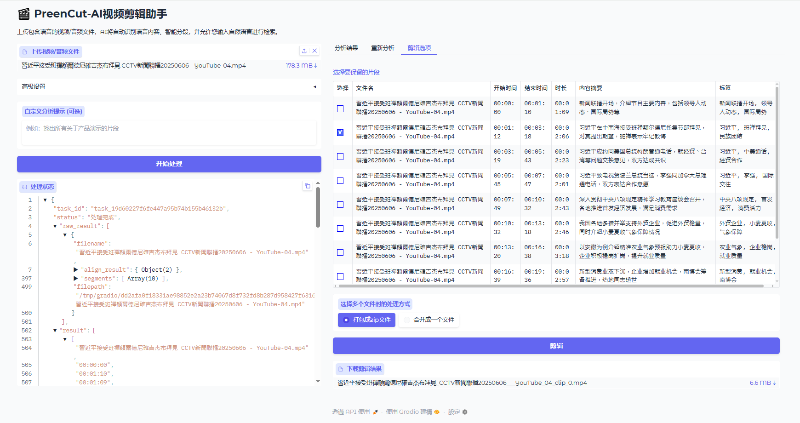

# 🎬 PreenCut - AI-Powered Video Clipping Tool

[](https://opensource.org/licenses/MIT)
[](https://www.python.org/downloads/)
[](https://gradio.app/)

PreenCut is an intelligent video editing tool that automatically analyzes audio/video content using speech recognition
and large language models. It helps you quickly find and extract relevant segments from your media files using natural
language queries.



## ✨ Key Features

- **Automatic Speech Recognition**: Powered by OpenAI Whisper for accurate transcription
- **AI-Powered Analysis**: Uses large language models to segment and summarize content
- **Natural Language Querying**: Find clips using descriptive prompts like "Find all product demo segments"
- **Smart Clipping**: Select and export segments as individual files or merged video
- **SRT Export**: Generate subtitles with accurate timestamps and custom line length
- **Batch Processing**: find a specific topic across multiple files
- **Re-analysis**: Experiment with different prompts without reprocessing audio
- **Optional TwelveLabs backend**: Segment directly from video frames + audio (Marengo retrieval + Pegasus analysis) for speech-light content — opt-in via `SEGMENTER_TYPE=twelvelabs`

## ⚙️ Installation

1. Clone the repository:

```bash
git clone https://github.com/roothch/PreenCut.git
cd PreenCut
```

2. Install dependencies, recommend creating a conda virtual environment and using Python 3.9+:

```bash
pip install -r requirements.txt
```

3. Install FFmpeg (required for video processing):

```bash
# ubuntu/Debian
sudo apt install ffmpeg

# CentOS/RHEL
sudo yum install ffmpeg

# macOS (using Homebrew)
brew install ffmpeg

# Windows: Download from https://ffmpeg.org/
```

4. Set up API keys (for LLM services):
First you need to set your llm services in LLM_MODEL_OPTIONS of `config.py`.
Then set your API keys as environment variables:

```bash
# for example, if you are using DeepSeek and DouBao as LLM services
export DEEPSEEK_V3_API_KEY=your_deepseek_api_key
export DOUBAO_1_5_PRO_API_KEY=your_doubao_api_key
```

5. (Optional)set up gradio temp file directory:
  set os.environ['GRADIO_TEMP_DIR'] in config.py file.

6. (Optional) Use TwelveLabs as the segmentation backend:

By default PreenCut segments video by running Whisper transcription and asking an
LLM to split the transcript. As an opt-in alternative you can use
[TwelveLabs](https://twelvelabs.io) to segment directly from the video frames and
audio — useful when there is little or no speech (sports, b-roll, surveillance, music
videos). It uses **Marengo** for semantic retrieval and **Pegasus** for clip
summaries/tags, and returns the same `{start, end, summary, tags}` structure, so the
existing analysis/clip/export flow is unchanged.

```bash
export SEGMENTER_TYPE=twelvelabs
export TWELVELABS_API_KEY=your_twelvelabs_api_key
# optional overrides:
# export TWELVELABS_INDEX_NAME=preencut   # index reused across runs
# export TWELVELABS_MAX_CLIPS=10          # max segments per file
```

Grab a free API key at https://twelvelabs.io — there's a generous free tier.
Leave `SEGMENTER_TYPE` unset (or `llm`) to keep the default behavior.

## 🚀 Usage

1. Start the Gradio interface:

```bash
python main.py
```

2. Access the web interface at http://localhost:7860
3. Upload video/audio files (supported formats: mp4, avi, mov, mkv, ts, mxf, mp3, wav, flac)
4. Configure options:

  - Select LLM model
  - Choose Whisper model size (tiny → large-v3)
  - Add custom analysis prompt (Optional)

5. Click "Start Processing" to analyze content
6. View results in the analysis table:

  - Start/end timestamps
  - Duration
  - Content summary
  - AI-generated tags

7. Use the "Re-analyze" tab to experiment with different prompts
8. Use the "Cut" tab to select segments and choose export mode:

  - Export as ZIP package
  - Merge into a single video file

9. you can also visit the Restful api use the route prefix /api/xxx

    * upload file

      > POST /api/upload
      
      body: formdata

      | key  | value type ||
      |------|------------|-|
      | file | file       |

      reponse: json
      ```
        { file_path: f'${GRADIO_TEMP_DIR}/files/2025/05/06/uuid.v1().replace('-', '')${file_extension}' }
      ```

    * create task

      > POST /api/tasks
      
      body: json

      ```json
      {
        "file_path": "put the file path here response from upload api, starting with ${GRADIO_TEMP_DIR}",   
        "llm_model": "DeepSeek-V3-0324",
        "whisper_model_size": "large-v2",
        "prompt": "提取重要信息，时间控制在10s"
      }
      ```

      response: 
      ```json
        { "task_id": "" }
      ```
    * query task reult
    
      GET /api/tasks/{task_id}
      
      response:
      ```json
      {
        "status": "completed",
        "files": [
            "${GRADIO_TEMP_DIR}/files/2025/06/23/608ecc80500e11f0b08a02420134443f.wav"
        ],
        "prompt": "提取重要信息，时间控制在10s",
        "model_size": "large-v2",
        "llm_model": "DeepSeek-V3-0324",
        "timestamp": 1750668370.6088192,
        "status_info": "共1个文件，正在处理第1个文件",
        "result": [
            {
                "filename": "608ecc80500e11f0b08a02420134443f.wav",
                "align_result": {
                    "segments": [
                        {
                            "text": "有内地媒体报道,嫦娥6号着陆器上升器组合体已经完成了钻取采样,接着正按计划进行月面的表取采样。",
                            "start": 1.145,
                            "end": 9.329
                        }
                    ],
                    "language": "zh"
                },
                "segments": [
                    {
                        "start": 1.145,
                        "end": 9.329,
                        "summary": "嫦娥6号着陆器上升器组合体已完成钻取采样，正进行月面表取采样。",
                        "tags": [
                            "嫦娥6号",
                            "月球采样",
                            "航天科技"
                        ]
                    }
                ],
                "filepath": "${GRADIO_TEMP_DIR}/files/2025/06/23/608ecc80500e11f0b08a02420134443f.wav"
            }
        ],
        "last_accessed": 1750668836.8038888
      }
      ```

## 💻 Development
```bash
python3 -m uvicorn main:app --port 7860 --reload
```

## ⚡ Performance Tips
  - Use faster-whisper for shorter segments, use whisperx for faster processing
  - Adjust WHISPER_BATCH_SIZE based on available VRAM when using whisperx
  - Use smaller model sizes for CPU-only systems
  - set ENABLE_ALIGNMENT=False to improve processing speed if you don't need accurate subtitle timestamps

## 📜 License
This project is licensed under the MIT License. See the [LICENSE](LICENSE) file for details.

## 💬 Community Communication
- Email: 1242727205@qq.com 
- RedNote(小红书): [一去二三里](https://www.xiaohongshu.com/user/profile/60c4b6df000000000101eedd)
- RedNote Group


## ⭐ Star History

[](https://www.star-history.com/#roothch/preencut&Date)

